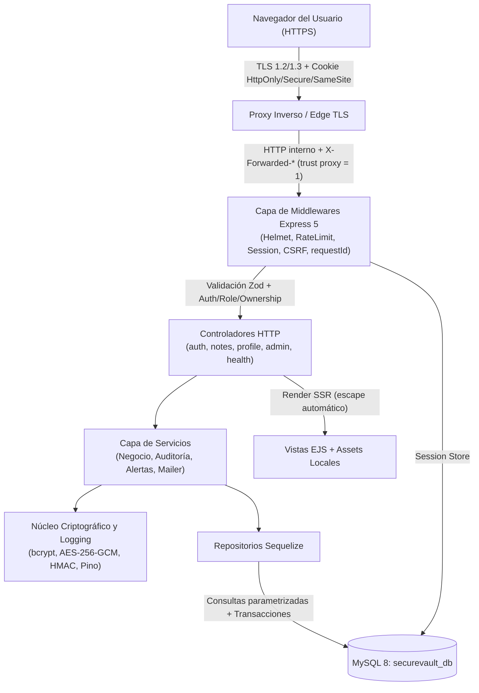
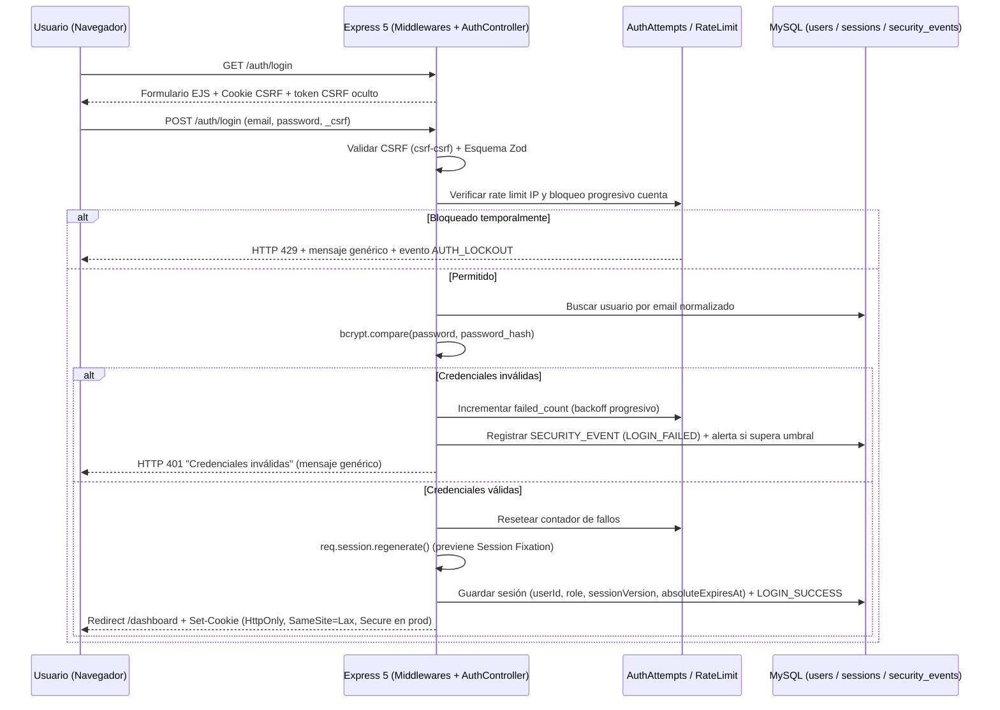

# Arquitectura del Sistema — SecureVault

## 1. Visión Arquitectónica

**SecureVault** adopta una arquitectura de **Monolito Modular Renderizado en Servidor (SSR)** con Node.js 22 LTS, Express 5 (ES Modules), EJS, Sequelize ORM y MySQL (`securevault_db`). Esta elección elimina la complejidad innecesaria de separar SPA/microservicios y concentra los controles de seguridad en una única frontera controlada en el servidor:

- **Presentación (`views/` + `public/`):** Plantillas EJS con escape automático (`<%= ... %>`), CSS modular propio con variables de diseño, fuentes e iconos servidos localmente (sin CDNs externos para mantener una CSP estricta).
- **Entrada HTTP y Seguridad (`middlewares/` + `validators/`):** Helmet (CSP, HSTS, `X-Content-Type-Options`, desactivación de `X-Powered-By`), CORS restrictivo, `express-rate-limit`, `express-session` persistido en MySQL, protección CSRF (`csrf-csrf`), correlación de peticiones (`requestId`) y validación estricta con `Zod`.
- **Controladores (`controllers/`):** Orquestación HTTP pura (sin SQL ni lógica criptográfica directa).
- **Servicios (`services/`):** Reglas de negocio, verificación de propiedad, límites de negocio (máximo de notas/tamaño), registro de eventos de seguridad y alertas.
- **Repositorios y Modelos (`repositories/` + `models/`):** Acceso parametrizado a MySQL mediante Sequelize ORM.
- **Núcleo Criptográfico y Utilidades (`lib/`):** `crypto.js` (AES-256-GCM con versionado de llaves, SHA-256, HMAC-SHA256), `password.js` (bcrypt), `logger.js` (Pino con redacción de campos sensibles) y `mailer.js`.

---

## 2. Diagrama de Arquitectura



---

## 3. Estructura Modular del Proyecto

```text
securevault/
├── src/
│   ├── config/          # Validación Zod de env, config DB Sequelize, constantes de seguridad
│   ├── controllers/     # Controladores HTTP (auth, dashboard, notes, profile, admin, health)
│   ├── services/        # Lógica de negocio, auditoría HMAC, alertas, MFA/rotación (bonificación)
│   ├── repositories/    # Consultas encapsuladas a modelos Sequelize
│   ├── models/          # Definición de modelos y asociaciones Sequelize
│   ├── routes/          # Rutas Express 5 con middlewares explícitos
│   ├── middlewares/     # requireAuth, requireRole, requireOwnership, csrf, rateLimit, errorHandler
│   ├── validators/      # Esquemas Zod y listas blancas de campos
│   ├── lib/             # crypto.js, password.js, logger.js, mailer.js
│   ├── views/           # layouts/, partials/, auth/, dashboard/, notes/, profile/, admin/, errors/
│   ├── public/          # css/, js/, fonts/, images/ (recursos locales para CSP estricta)
│   ├── app.js           # Composición de Express 5 (sin listen)
│   └── server.js        # Arranque, validación de DB y graceful shutdown (SIGTERM/SIGINT)
├── migrations/          # Migraciones SQL/Sequelize versionadas
├── seeders/             # Seeders de desarrollo y demo controlada
├── tests/               # unit/, integration/, security/
├── scripts/             # check-release, rotación de llaves, utilidades operativas
└── docs/                # deep-research, architecture, threat-model, informe-seguridad, etc.
```

---

## 4. Modelo Relacional MySQL (`securevault_db`)

### 4.1 Diagrama Entidad-Relación

```mermaid
erDiagram
    USERS ||--o| USER_PROFILES : "tiene"
    USERS ||--o| USER_MFA : "configura"
    USERS ||--o{ NOTES : "posee"
    USERS ||--o{ PASSWORD_RESET_TOKENS : "solicita"
    USERS ||--o{ SECURITY_EVENTS : "origina"

    USERS {
        char_36 id PK
        varchar_120 name
        varchar_254 email UK
        varchar_255 password_hash
        enum_user_admin role
        enum_active_suspended status
        int_unsigned session_version
        datetime created_at
        datetime updated_at
    }

    USER_PROFILES {
        char_36 id PK
        char_36 user_id UK_FK
        text encrypted_phone
        varchar_16 key_version
        datetime created_at
        datetime updated_at
    }

    USER_MFA {
        char_36 id PK
        char_36 user_id UK_FK
        text encrypted_secret
        varchar_16 key_version
        boolean enabled
        datetime verified_at
        datetime created_at
        datetime updated_at
    }

    NOTES {
        char_36 id PK
        char_36 owner_id FK
        text encrypted_title
        mediumtext encrypted_content
        varchar_16 key_version
        datetime created_at
        datetime updated_at
    }

    PASSWORD_RESET_TOKENS {
        char_36 id PK
        char_36 user_id FK
        char_64 token_hash UK
        datetime expires_at
        datetime used_at
        datetime created_at
    }

    SECURITY_EVENTS {
        bigint_unsigned id PK
        char_36 actor_user_id FK
        varchar_80 event_type
        enum_severity severity
        char_36 request_id
        json metadata
        char_64 integrity_signature
        datetime created_at
    }

    AUTH_ATTEMPTS {
        bigint_unsigned id PK
        varchar_96 scope_key UK
        int_unsigned failed_count
        datetime locked_until
        datetime last_attempt_at
        datetime created_at
        datetime updated_at
    }

    SESSIONS {
        varchar_128 session_id PK
        int_unsigned expires
        mediumtext data
    }
```

### 4.2 Decisiones de diseño de tablas, índices y restricciones

| Tabla | Clave primaria / Foráneas | Índices y restricciones clave | Justificación de seguridad |
|---|---|---|---|
| `users` | PK `id` (`CHAR(36)` UUID v4) | `UNIQUE(email)` normalizado a minúsculas/trim; `role` `ENUM('user','admin')` default `'user'`; `status` `ENUM('active','suspended')`; `session_version` `INT UNSIGNED DEFAULT 1`. | Evita enumeración secuencial de IDs; `session_version` permite invalidar en $O(1)$ todas las sesiones activas tras cambiar o restablecer contraseña (RF-06). |
| `user_profiles` | PK `id` (`CHAR(36)`), FK `user_id` → `users.id` (`ON DELETE CASCADE`) | `UNIQUE(user_id)`; `key_version` `VARCHAR(16)` indexado. | El teléfono se cifra con AES-256-GCM usando AAD ligado a `user_id`. Solo se descifra para enmascaramiento o revelación explícita al dueño (RF-05). |
| `user_mfa` | PK `id` (`CHAR(36)`), FK `user_id` → `users.id` (`ON DELETE CASCADE`) | `UNIQUE(user_id)`. | Aísla el secreto TOTP cifrado del registro base de `users` (principio de mínimo privilegio, bonificación MFA). |
| `notes` | PK `id` (`CHAR(36)`), FK `owner_id` → `users.id` (`ON DELETE CASCADE`) | `INDEX idx_notes_owner_updated (owner_id, updated_at)`; `INDEX idx_notes_key_version (key_version)`. | Tanto el título (`encrypted_title`) como el contenido (`encrypted_content`) se cifran con AES-256-GCM e IV único. Toda consulta filtra por `owner_id` y `id`. |
| `password_reset_tokens` | PK `id` (`CHAR(36)`), FK `user_id` → `users.id` (`ON DELETE CASCADE`) | `UNIQUE(token_hash)` (`CHAR(64)` SHA-256 hex); `INDEX idx_prt_user_expires (user_id, expires_at)`. | Nunca almacena el token original; registra `used_at` en transacción atómica para garantizar uso único (RF-06). |
| `security_events` | PK `id` (`BIGINT UNSIGNED AUTO_INCREMENT`), FK `actor_user_id` → `users.id` (`ON DELETE SET NULL`) | `INDEX idx_se_created (created_at)`; `INDEX idx_se_type_sev (event_type, severity)`; `INDEX idx_se_req (request_id)`. | Bitácora inmutable de aplicación firmada por fila con `HMAC-SHA256` (`integrity_signature`). Prohibido guardar contraseñas, tokens o texto descifrado. |
| `auth_attempts` | PK `id` (`BIGINT UNSIGNED AUTO_INCREMENT`) | `UNIQUE(scope_key)` (`ip:<hash>` o `acct:<sha256(email)>`); `INDEX idx_aa_locked (locked_until)`. | Soporta bloqueo progresivo persistente en MySQL sin exponer correos inexistentes ni permitir bloqueo permanente (A07). |
| `sessions` | PK `session_id` (`VARCHAR(128)`) | `INDEX idx_sessions_expires (expires)` (esquema estándar de `express-mysql-session`). | Sesiones persistentes fuera de memoria con expiración absoluta y por inactividad verificada en servidor. |

### 4.3 Búsqueda de notas por título sin debilitar el cifrado (RF-04)

Para proteger títulos potencialmente sensibles en reposo, `notes.encrypted_title` utiliza **AES-256-GCM** con IV aleatorio (no determinista). Como cada usuario tiene un límite configurable de negocio (p. ej. `MAX_NOTES_PER_USER = 100`), la búsqueda por título consulta únicamente los registros del propietario (`WHERE owner_id = :currentUserId`), descifra sus títulos en memoria del servidor y aplica el filtro de subcadena en memoria. Así se evita usar cifrado determinista o índices ciegos que filtren igualdad/frecuencia de títulos en la base de datos.

---

## 5. Flujo de Autenticación, Sesiones y Protección CSRF



---

## 6. Diseño Criptográfico y Gestión de Llaves

Centralizado exclusivamente en `src/lib/password.js` y `src/lib/crypto.js`:

1. **Contraseñas (`password.js`):** `bcrypt` con costo 12. Se rechazan contraseñas de más de 72 bytes UTF-8 para evitar truncamiento silencioso; esto limita el máximo anterior de 128 caracteres.
2. **Cifrado de notas, teléfono y secreto TOTP (`crypto.js`):** `AES-256-GCM` con llave de 32 bytes, IV aleatorio de 12 bytes (`crypto.randomBytes(12)`) por operación y auth tag de 16 bytes. El AAD de notas incluye propietario, identificador de nota y campo, para impedir intercambios entre registros o campos; para el perfil incluirá usuario y campo.
   - Formato persistido: `version.iv.tag.ciphertext` (base64 para iv, tag y ciphertext).
   - Permite **rotación de llaves sin pérdida de datos**: `DATA_ENCRYPTION_KEYS` admite múltiples versiones (ej. `v1:<keyBase64>,v2:<keyBase64>`) y `DATA_ENCRYPTION_KEY_CURRENT` indica la versión activa para nuevos cifrados o re-cifrado controlado.
3. **Tokens de recuperación (`crypto.js`):** `crypto.randomBytes(32).toString('hex')` entregado por correo; en `password_reset_tokens` se guarda únicamente `SHA-256(token)`.
4. **Integridad de auditoría (`crypto.js`):** `HMAC-SHA256` con `HMAC_SECRET` independiente de `DATA_ENCRYPTION_KEY`, calculado sobre una representación JSON canónica de `(actor_user_id, event_type, severity, request_id, metadata, created_at)`.

---

## 7. Sistema de Diseño Visual UI/UX

- **Estética:** Corporativa, minimalista, tecnológica y sobria (sin emojis como iconos ni efectos neón).
- **Paleta CSS (variables en `:root`):**
  - `--color-navy: #0F172A` (sidebar / encabezados de alto contraste)
  - `--color-primary: #2563EB` (acciones primarias y foco)
  - `--color-bg: #F8FAFC`, `--color-surface: #FFFFFF`
  - `--color-text-muted: #64748B`, `--color-border: #E2E8F0`
  - `--color-success: #15803D`, `--color-warning: #D97706`, `--color-danger: #DC2626`
- **Tipografía e iconografía local:** Fuente `Inter` (o `Manrope`) y `Material Symbols Outlined` empaquetadas localmente en `src/public/fonts/` para cumplir `default-src 'self'; font-src 'self'` en CSP sin depender de dominios externos.
- **Pantallas obligatorias (13):** Login, Registro, Recuperación de contraseña, Restablecimiento de contraseña, Dashboard de usuario, Listado de notas privadas, Creación/edición de notas, Perfil personal, Configuración de seguridad (sesiones activas / MFA), Dashboard administrativo, Administración de usuarios, Bitácora de seguridad y Alertas de seguridad, más páginas de error `403`, `404` y `500`.
- **Responsividad:** Layout adaptable con navegación colapsable validada en `1440px`, `768px` y `390px`.
