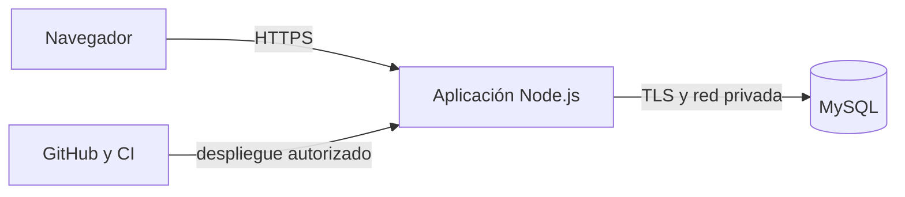

# Deep Research: despliegue de SecureVault

> PR08: la preparación de producción y las fuentes actualizadas se detallan al final; el despliegue todavía no se ha realizado.

**Fecha de consulta:** 25 de noviembre de 2026. **Estado:** investigación actualizada; despliegue no realizado. Los límites y precios pueden cambiar y deben verificarse antes de publicar.

## Resumen ejecutivo

SecureVault pretende ejecutar Express y Sequelize con MySQL para proteger notas. Un despliegue requiere secretos fuera del código, conexiones protegidas, persistencia y verificaciones externas. Se comparan Railway, Render y Google Cloud Run. Railway con MySQL es la candidata inicial, sujeta a presupuesto, TLS de base de datos y autorización. El proyecto aún rechaza producción y no tiene aplicación completa.

## Respuestas a las diez preguntas

1. **PaaS, contenedores y VPS/IaaS.** El PaaS gestiona parte de la red y operación; el contenedor empaqueta el programa, pero necesita infraestructura para ejecutarlo. En un VPS el equipo administra sistema operativo, parches y firewall. Más control conlleva más mantenimiento. No existe todavía Dockerfile en este proyecto. [1][2]

2. **Comparación de plataformas.** Los valores son los publicados por los proveedores; comprobar región, facturación y disponibilidad para la cuenta antes de crear servicios. [1][2][12][13]

| Aspecto             | Railway Free / prueba                                                             | Render Free                                                                                   | Google Cloud Run                                                                                                                     |
| ------------------- | --------------------------------------------------------------------------------- | --------------------------------------------------------------------------------------------- | ------------------------------------------------------------------------------------------------------------------------------------ |
| Costo / duración    | Crédito mensual de 1 USD; prueba inicial de 5 USD o 30 días.                      | 750 horas de instancia por workspace y mes; posibles cargos según consumo y cuenta.           | Cuota gratuita mensual de uso; excedentes y servicios adicionales pueden cobrarse. El nivel estándar requiere cuenta de facturación. |
| Inactividad         | Free duerme tras 5–10 minutos sin tráfico saliente; al agotar crédito se detiene. | Duerme tras 15 minutos sin tráfico entrante; puede tardar alrededor de un minuto en reanudar. | Puede escalar a cero con configuración adecuada; verificar límites y tiempos de arranque.                                            |
| Node.js y HTTPS     | Servicio web y certificados gestionados.                                          | Servicio Node.js y TLS gestionado.                                                            | Acepta contenedores o código Node.js y ofrece URL HTTPS gestionada.                                                                  |
| MySQL               | Plantilla MySQL y volumen sujetos a límites del plan.                             | Requiere MySQL externo o autogestionado; Free no lista MySQL gestionado.                      | Puede conectarse a Cloud SQL para MySQL; la base tiene costos y no debe asumirse gratuita.                                           |
| Regiones / secretos | Red privada y variables; selección condicionada por el plan.                      | Variables de entorno; verificar región disponible.                                            | Regiones y secretos configurables; revisar cargos y cuotas de la región.                                                             |

Render advierte que Free no es para producción. Cloud Run tiene una cuota gratuita de cómputo, pero no garantiza una solución MySQL gratuita; Cloud SQL y otros recursos pueden generar costos. La disponibilidad académica puede requerir autorización y presupuesto. [12][13]

3. **Secretos.** En local se usa un archivo ignorado por Git; en producción se inyectan desde el gestor de la plataforma. Sesión, cifrado y HMAC requieren llaves distintas, respaldo seguro y rotación controlada. Nunca incluirlas en logs, Git o imágenes. [4]

4. **TLS y HSTS.** Un certificado permite autenticar un dominio y establecer HTTPS; Let's Encrypt automatiza emisión y renovación mediante ACME. HSTS indica al navegador usar HTTPS en visitas posteriores y no protege por sí solo la primera visita previa a recibir la política. [5][6]

5. **Proxy inverso.** Puede terminar TLS y reenviar peticiones. Express debe confiar solo en proxies reales y cabeceras que estos saneen; el valor de trust proxy depende de la topología y no debe fijarse sin verificarla. [6]

6. **Procesos.** En un VPS puede usarse systemd; en un PaaS el orquestador suele reiniciar el contenedor. El programa debe atender SIGTERM y cerrar servidor y conexiones de forma ordenada. [7]

7. **CI/CD.** Instalar con npm ci, ejecutar lint, pruebas, auditoría y escaneo de secretos antes de una construcción y despliegue autorizados. Railway ofrece Wait for CI; el workflow local es parcial y todavía no se ha ejecutado en GitHub. [8]

8. **MySQL gestionado.** La plantilla de Railway ofrece MySQL y red privada. Se requieren persistencia, respaldo probado, TLS validado y usuarios separados: DML para la aplicación y DDL controlado para migraciones. Red privada no demuestra por sí sola que el cliente MySQL use TLS. TiDB no se adopta porque es otro motor, aunque sea compatible con el protocolo MySQL. [9]

9. **Desarrollo y producción.** Producción necesita secretos gestionados, cookies seguras, HTTPS, errores públicos genéricos, logs sanitizados y proxy comprobado. El código actual rechaza NODE_ENV=production mientras faltan los controles.

10. **Verificaciones posteriores.** Tras autorización, comprobar HTTPS, redirección, certificado, cabeceras, cookies, health, persistencia y roles con datos sintéticos. Ejecutar npm audit, ZAP Baseline, Security Headers y SSL Labs. No hay resultados públicos verificados. [10][11]

## Plan propuesto

Railway es una candidata inicial con aplicación web y MySQL privado. Antes de crear servicios hay que terminar el producto, verificar el presupuesto y obtener autorización. Comprobar TLS MySQL, respaldo, permisos mínimos y migraciones separadas en la instancia real.

El diagrama es una propuesta, no evidencia de infraestructura existente. No hay URL pública verificada.

## Referencias consultadas

1. Railway: [plan Free](https://docs.railway.com/pricing/free-plan).
2. Render: [servicios gratuitos](https://render.com/docs/free).
3. Fly.io: [prueba gratuita](https://fly.io/docs/about/free-trial/).
4. GitHub: [secretos de Actions](https://docs.github.com/en/actions/security-for-github-actions/security-guides/using-secrets-in-github-actions).
5. Let's Encrypt: [ACME](https://letsencrypt.org/how-it-works/).
6. Express: [proxies](https://expressjs.com/en/guide/behind-proxies/).
7. Express: [health y cierre ordenado](https://expressjs.com/en/advanced/healthcheck-graceful-shutdown.html).
8. Railway: [despliegues GitHub y CI](https://docs.railway.com/deployments/github-autodeploys).
9. Railway: [MySQL](https://docs.railway.com/databases/mysql).
10. OWASP ZAP: [Baseline Scan](https://www.zaproxy.org/docs/docker/baseline-scan/).
11. Qualys: [SSL Server Test](https://www.ssllabs.com/ssltest/).
12. Google Cloud: [precios de Cloud Run](https://cloud.google.com/run/pricing).
13. Google Cloud: [Cloud Run con Cloud SQL para MySQL](https://docs.cloud.google.com/sql/docs/mysql/connect-instance-cloud-run).

Se generó una versión PDF local y se comprobaron dos páginas. La revisión visual y académica final del documento sigue pendiente.
# Actualización PR08 — configuración de despliegue

Se preparó un Dockerfile y una configuración que exige TLS para MySQL, pero la construcción y el despliegue no se han probado. La documentación actual de Railway indica que la configuración anterior `railway.json`/`railway.toml` está [descontinuada para servicios nuevos](https://docs.railway.com/config-as-code). La [red privada](https://docs.railway.com/networking/private-networking/how-it-works) usa túneles cifrados, lo que no verifica por sí mismo un certificado TLS MySQL ni la configuración concreta de una instancia.
