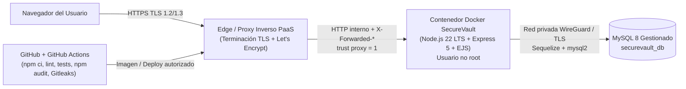

# Deep Research — Fase 0: Despliegue Seguro de Aplicaciones Node.js en Producción

**Proyecto:** SecureVault (Node.js + Express 5 + Sequelize + MySQL)  
**Fase:** 0 — Investigación previa al diseño e implementación  
**Fecha:** 25 de noviembre de 2026

---

## 1. Resumen Ejecutivo

Desplegar una aplicación web orientada a seguridad como **SecureVault** exige ir más allá de "levantar un servidor": implica garantizar confidencialidad en tránsito mediante TLS, aislamiento de secretos criptográficos fuera del código fuente, persistencia segura de base de datos MySQL, encabezados de seguridad HTTP coherentes detrás de proxies inversos, reinicio automático ante fallos y un flujo de integración continua (CI/CD) que detenga despliegues si existen vulnerabilidades o secretos filtrados.

En esta investigación se comparan los modelos de despliegue actuales (**PaaS**, **Contenedores/Docker** y **VPS/IaaS**) y se evalúan tres plataformas concretas vigentes con niveles gratuitos o de prueba (**Railway**, **Render** y **Fly.io**), analizando además su compatibilidad real con **MySQL gestionado** (incluyendo **TiDB Cloud Serverless** como alternativa MySQL-compatible gratuita con TLS obligatorio tras la retirada del plan gratuito de MySQL en Aiven).

Como resultado, se recomienda desplegar SecureVault mediante **Docker** en **Railway** como opción principal —gracias a su soporte nativo de MySQL gestionado sobre red privada cifrada con WireGuard, HTTPS automático vía Let's Encrypt y gestión integrada de secretos—, manteniendo una arquitectura completamente portable (a través de `Dockerfile` multi-stage y variables de entorno estándar) hacia **Render + TiDB Cloud Serverless** como plan de respaldo con costo cero a largo plazo.

---

## 2. Respuestas a las Preguntas de Investigación

### 2.1 Diferencias entre PaaS, Contenedores (Docker) y VPS/IaaS

| Modelo | Control sobre SO e infraestructura | Carga operativa / mantenimiento | Costo típico inicial | Casos de uso y relación con SecureVault |
|---|---|---|---|---|
| **PaaS** (Render, Railway, Heroku) | Bajo–Medio: el proveedor gestiona SO, parches, red, TLS y proxy inverso. | Muy baja: despliegue desde Git/Dockerfile y variables en panel. | Plan gratuito o desde ~\$5–\$7/mes. | Ideal para equipos pequeños que priorizan seguridad de transporte y rapidez de entrega sin administrar servidores Linux. |
| **Contenedores** (Docker en PaaS o Fly.io) | Medio–Alto: control total sobre versión exacta de Node.js, dependencias del sistema y usuario no root dentro de la imagen. | Media: requiere mantener `Dockerfile`, escaneo de imagen y configuración de arranque. | Variable según orquestador (\$0–\$5/mes en capas iniciales). | Garantiza paridad entre desarrollo y producción y permite ejecutar la app con usuario no root (bonificación de seguridad). |
| **VPS / IaaS** (AWS EC2, DigitalOcean Droplet, Azure VM) | Total: acceso root al sistema operativo, firewall (`ufw`), proxy (Nginx/Caddy) y BD. | Alta: el equipo es responsable de parches del SO, Certbot/TLS, PM2/systemd, backups y endurecimiento SSH. | Desde ~\$4–\$6/mes (o capas gratuitas temporales como AWS Free Tier). | Apropiado cuando se requieren configuraciones de red a medida; alto riesgo de mala configuración (OWASP A02) si no se administra bien. |

En **SecureVault**, combinar **Docker + PaaS** ofrece el mejor equilibrio: el contenedor encapsula Node.js LTS con usuario no root y dependencias reproducibles (`npm ci`), mientras el PaaS resuelve TLS, proxy inverso y reinicio automático [1][2][3].

### 2.2 Comparación de tres plataformas concretas con plan gratuito o de prueba

Se analizaron tres plataformas vigentes verificando su documentación oficial de precios y capacidades: **Railway**, **Render** y **Fly.io** (ver tabla comparativa completa en la Sección 3).

### 2.3 Gestión de variables de entorno y secretos en producción

Un archivo `.env` local sirve únicamente para desarrollo: nunca debe versionarse en Git porque cualquier persona con acceso al historial tendría las llaves de cifrado (`DATA_ENCRYPTION_KEY`), el secreto de sesión (`SESSION_SECRET`) y las credenciales de MySQL [4][5]. Además, si un archivo `.env` se copia dentro de una imagen Docker, queda expuesto en las capas del contenedor.

En producción se utiliza un **gestor de secretos** (el almacén cifrado de variables de la plataforma PaaS, GitHub Actions Secrets o servicios dedicados como AWS Secrets Manager / HashiCorp Vault):
- Almacena los secretos cifrados en reposo (por ejemplo, Railway cifra las variables en reposo con AES-256) [6].
- Inyecta las variables en memoria únicamente en tiempo de ejecución del proceso o durante el paso autorizado del pipeline.
- Limita la visibilidad mediante control de acceso y enmascara valores en los logs de construcción y despliegue [7].

### 2.4 Certificado TLS, Let's Encrypt y HSTS

- **Certificado TLS:** Es un documento digital emitido por una Autoridad Certificadora (CA) que vincula una clave pública con un dominio, permitiendo cifrar el tráfico HTTP sobre **TLS 1.2 o TLS 1.3** y autenticar la identidad del servidor frente al navegador [8].
- **Let's Encrypt:** Es una CA gratuita, abierta y automatizada que opera mediante el protocolo **ACME (RFC 8555)**. Un cliente ACME valida el control del dominio mediante retos (`HTTP-01` en `/.well-known/acme-challenge/` o `DNS-01` vía registro TXT), emite certificados válidos por **90 días** y automatiza su renovación periódica sin intervención manual [8]. Tanto Railway como Render automatizan este ciclo para sus dominios y dominios personalizados [1][9].
- **HSTS (`Strict-Transport-Security`):** Es una cabecera HTTP de respuesta que indica al navegador que, durante un tiempo definido (`max-age`), debe comunicarse exclusivamente por HTTPS con ese dominio (y opcionalmente subdominios), evitando ataques de degradación (*SSL stripping*) en la primera visita tras el registro [10].

### 2.5 Proxy inverso y `trust proxy` en Express

Un **proxy inverso** (como Nginx, Caddy o el edge network de un PaaS) se sitúa entre internet y el proceso Node.js para terminar la conexión TLS, filtrar peticiones maliciosas, comprimir respuestas, balancear carga y redirigir HTTP hacia HTTPS [11].

Dado que el proxy termina el TLS y reenvía tráfico interno HTTP hacia Node.js, Express vería por defecto la IP interna del proxy y el protocolo `http`. Al configurar `app.set('trust proxy', 1)` (cuando existe exactamente un salto de proxy de confianza delante de la app), Express lee las cabeceras `X-Forwarded-For` y `X-Forwarded-Proto` del último proxy confiable [11]. Esto es indispensable para que:
1. `req.secure` sea `true` y `express-session` emita cookies con el atributo `Secure`.
2. `express-rate-limit` identifique la IP real del cliente y no bloquee a todos los usuarios compartiendo la IP del proxy.

**Advertencia:** Nunca debe usarse `app.set('trust proxy', true)` indiscriminadamente en producción, pues confiaría en cabeceras `X-Forwarded-*` falsificables si el proxy frontal no las sobrescribe [11]. En su lugar se fija el número exacto de saltos (`1`) o la subred confiable.

### 2.6 Gestores de procesos (`PM2`, `systemd`) vs Contenedores / PaaS

Un gestor de procesos tradicional como **PM2** o **systemd** mantiene vivo el proceso `node` en un VPS, reiniciándolo si ocurre una excepción no capturada y gestionando logs o modo clúster. Sin embargo, dentro de un **contenedor Docker** o un **PaaS**, el propio runtime del contenedor y el orquestador de la plataforma esperan que `node` sea el proceso principal (PID 1) que recibe señales como `SIGTERM` para apagado ordenado (*graceful shutdown*), monitorizan el `/health` check y reinician el contenedor completo si falla. Añadir PM2 dentro de Docker agrega complejidad innecesaria y puede interferir con el manejo de señales y la recolección de logs hacia `stdout`/`stderr` [12].

### 2.7 CI/CD con GitHub Actions

**CI/CD** (Integración Continua y Despliegue Continuo) automatiza la verificación de calidad y seguridad en cada `push` o `pull request`. Un pipeline mínimo seguro en `.github/workflows/ci.yml` sigue esta secuencia [7]:
1. `actions/checkout@v4` y `actions/setup-node@v4` con versión LTS fijada.
2. `npm ci` para instalación determinista basada exactamente en `package-lock.json`.
3. `npm run lint` y verificación de formato.
4. `npm test` (pruebas unitarias, de integración y de seguridad contra MySQL de prueba).
5. `npm audit --audit-level=high` (bloquea el pipeline si hay vulnerabilidades altas o críticas).
6. Escaneo de secretos (p. ej. **Gitleaks**) para evitar fugas en el historial Git.
7. Construcción de imagen Docker (sin `.env` ni secretos) y despliegue automático o mediante aprobación únicamente si todas las etapas previas pasaron.

### 2.8 Bases de datos gestionadas y conexión segura

Dado que **SecureVault** utiliza exclusivamente **MySQL** (`securevault_db`), las opciones gestionadas compatibles incluyen:
- **MySQL nativo en Railway:** Instancia MySQL provisionada dentro del proyecto, accesible internamente por red privada cifrada con WireGuard (sin exposición pública) y accesible externamente solo bajo demanda mediante TCP Proxy [6].
- **TiDB Cloud Serverless (Starter):** Plataforma distribuida compatible con el protocolo MySQL 8 con capa gratuita activa (hasta 25 GiB de almacenamiento por organización / 5 GiB por instancia, 250M *Request Units*/mes) y **TLS obligatorio** para todas las conexiones cliente [13].
- *(Nota verificada sobre alternativas: Aiven retiró la creación de nuevas instancias MySQL gratuitas el 6 de noviembre de 2026 y cerrará las existentes el 21 de diciembre de 2026, por lo que ya no es viable como capa gratuita de MySQL [14]).*

Para asegurar la conexión a la base de datos gestionada:
1. Exigir **TLS** (`ssl: { rejectUnauthorized: true }` con certificado CA cuando aplique) si el tráfico cruza redes públicas.
2. No exponer públicamente el puerto `3306` en despliegues internos/locales y usar redes privadas o listas blancas de IP cuando el proveedor lo soporte.
3. Crear un **usuario MySQL dedicado de mínimo privilegio** (`SELECT, INSERT, UPDATE, DELETE` sobre `securevault_db`), reservando credenciales con privilegios DDL únicamente para la ejecución controlada de migraciones.

### 2.9 Diferencias entre desarrollo y producción en Node.js

| Aspecto | Desarrollo | Producción |
|---|---|---|
| `NODE_ENV` | `development` | `production` (optimiza caché de vistas EJS y activa comportamiento seguro) [10]. |
| Logs (Pino) | Legibles para consola local, nivel `debug`/`info`, siempre redactando secretos. | JSON estructurado hacia `stdout`, nivel `info`/`warn`, con `request_id` y redacción estricta. |
| Manejo de errores | Detalle diagnóstico en logs locales sin exponer secretos. | Respuestas genéricas al cliente (sin stack traces ni detalles SQL) [10]. |
| Cookies y CSRF | `Secure: false` si se prueba en `http://localhost` local. | `Secure: true`, `HttpOnly: true`, `SameSite=Lax`, detrás de `trust proxy = 1` [11]. |
| CORS | Origen local (`http://localhost:3000`). | Deshabilitado o restringido estrictamente al dominio HTTPS público de producción. |

### 2.10 Verificaciones posteriores al despliegue

Tras publicar en HTTPS se deben ejecutar y documentar comprobaciones reales:
1. **Disponibilidad y redirección:** Confirmar `GET https://<dominio>/health` devuelve `200 OK` mínimo y que `http://` redirige `301/308` a `https://`.
2. **Cabeceras HTTP (`securityheaders.com`):** Verificar calificación **A o superior** (CSP estricta, HSTS, `X-Content-Type-Options: nosniff`, `Referrer-Policy`, `X-Frame-Options`/frame-ancestors).
3. **Configuración TLS (`Qualys SSL Labs`):** Validar TLS 1.2/1.3, ausencia de cifrados débiles y cadena de certificados válida.
4. **Escaneo dinámico (`OWASP ZAP Baseline Scan`):** Detectar alertas de cabeceras, cookies sin flags o fugas de información.
5. **Pruebas funcionales y de ataque controladas:** Verificar registro, login, cookies `HttpOnly; Secure; SameSite`, bloqueo `429` en fuerza bruta, rechazo `403/404` ante IDOR y rechazo de CSRF.

---

## 3. Tabla Comparativa de Plataformas de Despliegue

| Criterio | Railway (PaaS + Docker/Nixpacks) | Render (PaaS + Docker/Node) | Fly.io (MicroVMs / Contenedores) |
|---|---|---|---|
| **Costo / Plan gratuito o prueba** | Prueba de 30 días con \$5 de crédito (sin tarjeta); luego Plan Free con \$1/mes de crédito. Hobby desde \$5/mes [15]. | Plan Free \$0/mes (workspace Hobby): 750 horas de instancia/mes [16]. Starter desde \$7/mes [17]. | \$1 de crédito por 7 días sin tarjeta; con tarjeta, \$5/mes de margen gratuito (hasta 3 Machines) [18]. |
| **Límites de cómputo** | Free: 512 MB RAM, 1 vCPU, 0.5 GB volumen [15]. | Free: 512 MB RAM, ~0.1 CPU, disco efímero (sin discos persistentes en Free) [16]. | Hasta 3 Machines compartidas en Free plan; sin IPv4 dedicada gratuita [18]. |
| **Suspensión por inactividad** | Plan Free duerme tras 5–10 min sin actividad saliente (app y BD despiertan bajo demanda) [19]. Hobby no duerme. | Plan Free suspende tras 15 min sin tráfico HTTP; *cold start* de ~30–60 s [1]. | Configurable (`auto_stop_machines` / `auto_start_machines`) para optimizar créditos. |
| **Compatibilidad Node.js** | Nativa (Nixpacks/Railpack) y mediante `Dockerfile` multi-stage. | Nativa y mediante `Dockerfile`. | Basada en `Dockerfile` / contenedores OCI (`flyctl`). |
| **Soporte MySQL** | **Nativo en 1 clic** dentro de la misma red privada WireGuard [6][19]. | **No nativo** (solo Postgres gratis por 30 días). Requiere MySQL externo (p. ej. TiDB Cloud Starter) [13][16]. | **No nativo** en capa gratuita (Managed Postgres desde \$4/mes). Requiere volumen propio o MySQL externo [18]. |
| **HTTPS / TLS** | Automático (Let's Encrypt), TLS 1.2/1.3, redirección HTTP→HTTPS [6][9]. | Automático (Let's Encrypt / Google Trust Services) y redirección HTTP→HTTPS [1][20]. | Certificados SSL automáticos (primeros 10 dominios simples gratis) [18]. |
| **Regiones** | Múltiples regiones globales (EE. UU., Europa, Asia-Pacífico) [21]. | Oregon, Ohio, Virginia (EE. UU.), Frankfurt (DE) y Singapur [22]. | Amplia red edge global (múltiples regiones en América, Europa y Asia). |
| **Gestión de secretos** | Panel de variables cifradas en reposo con AES-256 por proyecto/entorno [6]. | Environment Variables y Secret Files gestionados en dashboard. | `fly secrets set` cifrados e inyectados en tiempo de ejecución. |
| **Persistencia y mantenimiento** | Volúmenes persistentes en BD MySQL; despliegue continuo con GitHub; mantenimiento muy bajo. | Disco efímero en Free Web Service (obligatorio usar BD externa); mantenimiento muy bajo. | Volúmenes ligados a región/máquina; requiere `fly.toml` y CLI (`flyctl`). |

---

## 4. Plan de Despliegue Propuesto para SecureVault

### 4.1 Plataforma elegida y justificación

1. **Plataforma primaria recomendada: Railway (Web Service Docker + MySQL gestionado)**, complementada con **GitHub Actions** para CI/CD.
   - **Justificación técnica:** SecureVault exige **MySQL** exclusivamente. Railway es la única de las tres plataformas comparadas que ofrece **MySQL gestionado en la misma red privada cifrada (WireGuard)** junto al contenedor Node.js dentro de su plan inicial sin tarjeta de crédito, evitando exponer el puerto `3306` a internet y reduciendo la superficie de ataque [6][15]. Además, automatiza TLS 1.2/1.3 (Let's Encrypt), redirección HTTP→HTTPS y reinicio automático ante fallos.
2. **Plan B sin vencimiento de créditos (si el crédito de \$1/mes en Railway resultara insuficiente): Render (Web Service Free con Docker) + TiDB Cloud Serverless (Starter Free, compatible MySQL con TLS obligatorio)**.
   - Como el proyecto está dockerizado (`Dockerfile` multi-stage con usuario no root) y lee toda su configuración de variables de entorno validades con Zod, migrar entre Railway y Render + TiDB Cloud no requiere modificar código fuente.

### 4.2 Diagrama de arquitectura de despliegue

### 4.3 Manejo de secretos, base de datos y pipeline

- **Secretos:** `SESSION_SECRET`, `DATA_ENCRYPTION_KEY` (32 bytes base64), `DATA_ENCRYPTION_KEYS` (para rotación por versión), `HMAC_SECRET` (llave independiente), `DB_*` y credenciales SMTP se configuran exclusivamente en el panel de secretos de la plataforma (nunca en Git ni dentro de la imagen Docker).
- **Base de datos:** Las migraciones (`npm run db:migrate`) se ejecutan de forma reproducible antes o durante la liberación del despliegue; la app se conecta con un usuario MySQL de privilegios mínimos y timeouts configurados.
- **Pipeline CI/CD:** Todo cambio en `main` pasa por `.github/workflows/ci.yml` (`npm ci`, ESLint, pruebas unitarias/integración/seguridad contra MySQL de servicio, `npm audit`, Gitleaks y validación de `docker build`). Cualquier fallo bloquea el despliegue.

---

## 5. Lista de Referencias

1. Render. *Free Tier – Render Docs*. Disponible en: https://render.com/docs/free
2. Node.js. *Security Best Practices*. Disponible en: https://nodejs.org/en/learn/getting-started/security-best-practices
3. OWASP Cheat Sheet Series. *NodeJS Docker Cheat Sheet*. Disponible en: https://cheatsheetseries.owasp.org/cheatsheets/Nodejs_Docker_Cheat_Sheet.html
4. OWASP Top 10:2025. *OWASP Top Ten 2025*. Disponible en: https://owasp.org/Top10/2025/
5. Node.js Documentation. *Crypto (`node:crypto`)*. Disponible en: https://nodejs.org/api/crypto.html
6. Railway Docs. *Security & Architecture / Public Networking & Private Networking*. Disponible en: https://docs.railway.com/reference/security
7. GitHub Docs. *Using secrets in GitHub Actions*. Disponible en: https://docs.github.com/en/actions/security-for-github-actions/security-guides/using-secrets-in-github-actions
8. Let's Encrypt. *How It Works (ACME Protocol)*. Disponible en: https://letsencrypt.org/how-it-works/
9. Railway Docs. *Public Networking & Custom Domains (TLS/HTTPS)*. Disponible en: https://docs.railway.com/guides/public-networking
10. Express.js Official Documentation. *Security Best Practices*. Disponible en: https://expressjs.com/en/advanced/best-practice-security.html
11. Express.js Official Documentation. *Express Behind Proxies (`trust proxy`)*. Disponible en: https://expressjs.com/en/guide/behind-proxies.html
12. Express.js Official Documentation. *Health Checks and Graceful Shutdown*. Disponible en: https://expressjs.com/en/advanced/healthcheck-graceful-shutdown.html
13. PingCAP / TiDB Cloud Docs. *TiDB Cloud Serverless (Starter) Tier & Limits*. Disponible en: https://docs.pingcap.com/tidbcloud/select-cluster-tier/
14. Aiven. *Retirement of Aiven for MySQL Free Tier*. Disponible en: https://aiven.io/docs/platform/concepts/free-plan
15. Railway Docs. *Pricing & Free Trial / Free Plan*. Disponible en: https://docs.railway.com/reference/pricing/free-trial
16. Render. *Pricing Plans*. Disponible en: https://render.com/pricing
17. Render Docs. *Web Services*. Disponible en: https://render.com/docs/web-services
18. Fly.io Docs. *Fly.io Pricing & Free Allowances*. Disponible en: https://fly.io/docs/about/pricing/
19. Railway Docs. *Serverless / App Sleeping & MySQL Guide*. Disponible en: https://docs.railway.com/guides/mysql
20. Render Docs. *TLS Certificates & Custom Domains*. Disponible en: https://render.com/docs/tls
21. Railway Docs. *Regions*. Disponible en: https://docs.railway.com/reference/regions
22. Render Docs. *Regions*. Disponible en: https://render.com/docs/regions
