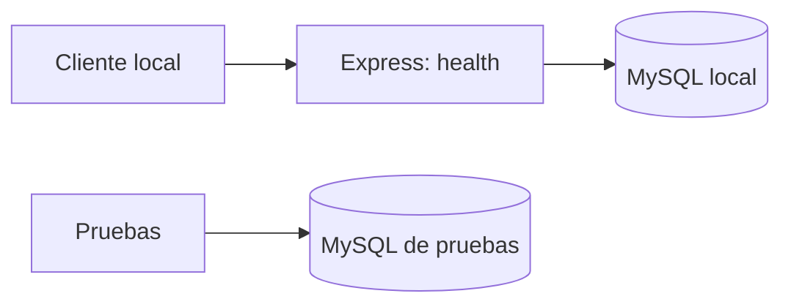

# Informe de seguridad — SecureVault

> PR08: los controles y resultados locales más recientes se describen en la actualización al final; el informe anterior conserva hallazgos históricos y no representa una verificación de producción.

## 1. Portada

**Estado: borrador incompleto; no apto para entrega final.**
Asignatura: pendiente. Integrantes: pendiente. Docente: pendiente. Fecha: 25 de noviembre de 2026.

## 2. Resumen ejecutivo

SecureVault es un proyecto académico de notas privadas. En el estado revisado solo existe un servidor local de salud, conexión MySQL y utilidades criptográficas. Registro, sesiones, notas, recuperación, administración, interfaz y despliegue están pendientes. Ver [auditoría PR05](PR05_AUDITORIA_SEGURIDAD.md).

## 3. Arquitectura y estado real

El backend utiliza Node.js, Express y Sequelize con MySQL. No existe frontend ni autenticación. bcrypt y AES-GCM son utilidades probadas aisladamente, no protección de flujos completos. No hay infraestructura pública verificada.

## 4. Requisitos funcionales

RF-01 registro, RF-02 sesión, RF-03 roles, RF-04 notas, RF-05 perfil, RF-06 recuperación y RF-07 administración: pendientes. RF-08 health: verificado localmente, no en producción. Ver [matriz](matriz-requisitos.md).

## 5. OWASP Top 10:2025

| Categoría                | Riesgo                   | Mitigación / archivo             | Prueba y evidencia                                | Estado    |
| ------------------------ | ------------------------ | -------------------------------- | ------------------------------------------------- | --------- |
| A01 Acceso               | Acceso indebido          | Recursos privados aún no existen | [A01](evidence/owasp/A01/README.md)               | Pendiente |
| A02 Configuración        | Ajustes inseguros        | Helmet en src/app.js             | Cabeceras, [A02](evidence/owasp/A02/README.md)    | Parcial   |
| A03 Cadena de suministro | Dependencias vulnerables | Lockfile y CI propuesto          | npm audit, [A03](evidence/owasp/A03/README.md)    | Parcial   |
| A04 Criptografía         | Exposición               | bcrypt y AES-GCM aislados        | [A04](evidence/owasp/A04/README.md)               | Parcial   |
| A05 Inyección            | Entradas maliciosas      | Límite JSON                      | Prueba 413, [A05](evidence/owasp/A05/README.md)   | Parcial   |
| A06 Diseño               | Falta de controles       | Modelo STRIDE                    | [A06](evidence/owasp/A06/README.md)               | Parcial   |
| A07 Autenticación        | Robo de cuentas          | bcrypt aislado                   | [A07](evidence/owasp/A07/README.md)               | Pendiente |
| A08 Integridad           | Alteración               | HMAC aislado                     | [A08](evidence/owasp/A08/README.md)               | Parcial   |
| A09 Logs y alertas       | Incidentes invisibles    | Pino inicial                     | [A09](evidence/owasp/A09/README.md)               | Pendiente |
| A10 Excepciones          | Fallo inseguro           | Errores genéricos                | 503 simulado, [A10](evidence/owasp/A10/README.md) | Parcial   |

## 6. Criptografía

El hash de contraseña es irreversible; el cifrado permite recuperar información con la llave. Por decisión del usuario se utiliza bcrypt costo 12, permitido por el documento académico, con máximo 72 bytes UTF-8. AES-256-GCM usa llave de 32 bytes, IV aleatorio de 12 y tag de 16; el AAD vincula nota y campo. Los tokens se generan con 32 bytes aleatorios y pueden almacenarse como SHA-256. HMAC-SHA256 detecta modificaciones, pero no garantiza detectar filas borradas.

Los algoritmos están probados en unidad, no en flujos finales. TLS, llaves independientes, integración y rotación están pendientes. Perder una llave sin respaldo puede hacer irrecuperables los datos; la rotación requiere mantener temporalmente versiones y recifrar con respaldo.

## 7. Modelo de amenazas

El [modelo STRIDE](threat-model.md) identifica activos, límites de confianza, suplantación, manipulación, repudio, divulgación, denegación de servicio y elevación de privilegios. Sus controles son en gran parte previstos, no implementados. El riesgo principal es exponer el sistema antes de autenticar y aislar recursos.

## 8. Verificaciones

La revisión PR06 ejecutó 15 pruebas distintas aprobadas (7 unitarias, 7 de seguridad y 1 de integración), npm audit sin altas/críticas pero con dos moderadas y liberación bloqueada. ZAP, Security Headers, SSL Labs y producción: pendientes, sin calificaciones inventadas. Ver [evidencias](evidence/README.md) y repetir pruebas tras cambios.

## 9. Bonificaciones

MFA, rotación real, Docker no root y alertas externas no están verificados. Gitleaks se ejecutó localmente pero CI no está verificada.

## 10. Riesgos residuales

La configuración Compose exige ahora contraseñas externas; el arranque real está pendiente y no cambia credenciales ya existentes. Faltan controles de autorización, gestión de llaves y publicación segura. Ver [modelo de amenazas](threat-model.md).

## 11. Conclusiones

SecureVault no está listo para evaluación final; los resultados locales no demuestran controles de producción ni sustituyen la aplicación requerida.

## 12. Referencias

[OWASP Top 10:2025](https://owasp.org/Top10/2025/), [Node crypto](https://nodejs.org/api/crypto.html), [ZAP Baseline](https://www.zaproxy.org/docs/docker/baseline-scan/) y [npm audit](https://docs.npmjs.com/cli/commands/npm-audit/).
# Actualización PR08 — alcance local

El proyecto integra controles de autenticación y sesiones, CSRF, bloqueo persistente por cuenta, protección de notas por propietario, cifrado AES-GCM de notas y teléfono, y HMAC en eventos seleccionados. Las pruebas locales incluyen aislamiento de cuentas y rol administrador, manipulación de eventos y cookies de producción tras un proxy simulado. La cobertura no demuestra cumplimiento integral de OWASP; la bitácora no detecta la eliminación de eventos y el limitador por IP es en memoria.

La recuperación con token de un solo uso fue probada con correo simulado; SMTP real no está configurado. HTTPS externo, TLS de MySQL, Docker, CI remota, ZAP, Security Headers y SSL Labs no se han verificado. La auditoría previa y resultados históricos se conservan a continuación.

PR09: Railway CLI fue detectado localmente, sin verificación de identidad ni de infraestructura. El mailer valida TLS/STARTTLS y admite nombres alternativos de contraseña SMTP; no existe proveedor HTTPS implementado ni configurado. Los planes Free, Trial y Hobby de Railway bloquean SMTP saliente, según su [documentación](https://docs.railway.com/networking/outbound-networking).
