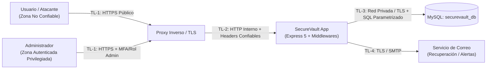

# Modelo de Amenazas (STRIDE) — SecureVault (OWASP A06:2025)

> PR08: se configuró `trust proxy = 1` únicamente para el modo de producción preparado; su adecuación a la topología real aún debe verificarse. Ver actualización al final.

> Estado del modelo: las mitigaciones de las tablas siguientes describen principalmente el diseño previsto, no controles ya verificados. La revisión actual por categoría y sus carencias están en [PR05_AUDITORIA_SEGURIDAD.md](PR05_AUDITORIA_SEGURIDAD.md). No asumir `trust proxy = 1`: debe establecerse según la topología real.

## 1. Activos Críticos del Sistema

| ID | Activo | Sensibilidad | Ubicación | Impacto ante compromiso |
|---|---|---|---|---|
| ACT-01 | Contenido y títulos de notas privadas | Crítica | MySQL (`notes`) y memoria durante renderizado | Pérdida de confidencialidad de datos personales del usuario. |
| ACT-02 | Credenciales de usuario (`password_hash`) | Crítica | MySQL (`users`) | Suplantación de identidad y acceso masivo si el hash es débil. |
| ACT-03 | Teléfono personal y secreto MFA | Alta | MySQL (`user_profiles`, `user_mfa`) | Exposición de PII y elusión de segundo factor. |
| ACT-04 | Cookies de sesión y tabla `sessions` | Crítica | Navegador (`HttpOnly`) y MySQL (`sessions`) | Secuestro de sesión (*Session Hijacking*). |
| ACT-05 | Llaves criptográficas (`DATA_ENCRYPTION_KEY`, `HMAC_SECRET`, `SESSION_SECRET`) | Crítica | Secretos de plataforma / `.env` local | Descifrado masivo o falsificación de firmas de auditoría. |
| ACT-06 | Tokens de recuperación de contraseña | Alta | Correo saliente y hash en `password_reset_tokens` | Toma de control de cuenta (*Account Takeover*). |
| ACT-07 | Bitácora `security_events` | Media-Alta | MySQL (`security_events`) y Pino JSON | Encubrimiento de intrusiones o fuga accidental de secretos en logs. |

---

## 2. Diagrama de Flujo de Datos (DFD) y Límites de Confianza

**Límites de confianza (*Trust Boundaries*):**
- **TL-1 (Internet → Edge):** Todo dato proveniente del navegador se considera hostil (entradas, cookies, cabeceras, parámetros de ruta).
- **TL-2 (Edge → Aplicación):** Solo se confía en `X-Forwarded-For` y `X-Forwarded-Proto` del salto inmediato (`trust proxy = 1`).
- **TL-3 (Aplicación → MySQL):** La aplicación usa un usuario MySQL de privilegios mínimos, consultas parametrizadas y cifrado previo en aplicación antes de persistir datos sensibles.
- **TL-4 (Aplicación → Mailer/Externos):** Los tokens nunca se registran en logs y cualquier canal externo de alertas usa URLs configuradas explícitamente por el administrador (sin destinos arbitrarios aportados por usuarios, evitando SSRF).

---

## 3. Casos de Abuso Documentados

1. **AB-01 (IDOR sobre notas privadas):** Un usuario autenticado cambia el UUID en `GET /notes/:id` o `POST /notes/:id/edit` para leer o sobrescribir la nota de otro usuario.
2. **AB-02 (Fuerza bruta y relleno de credenciales):** Un atacante automatiza miles de peticiones a `POST /auth/login` o intenta bloquear permanentemente la cuenta de la víctima (*account lockout DoS*).
3. **AB-03 (CSRF sobre cambios de perfil o rol):** Una página maliciosa induce al navegador de un usuario o administrador autenticado a enviar un formulario `POST` para modificar su teléfono o escalar privilegios.
4. **AB-04 (XSS almacenado en notas o perfil):** Un usuario guarda `` dentro del título o cuerpo de una nota esperando que se ejecute al renderizarse en EJS.
5. **AB-05 (Exfiltración de llaves o secretos vía logs / Git):** Un error no controlado o un registro de Pino imprime `req.body.password`, el token de recuperación o una variable de entorno.
6. **AB-06 (Manipulación de registros en BD):** Alguien con acceso de solo lectura/escritura parcial modifica `notes.encrypted_content` o altera un evento en `security_events` para ocultar evidencia.

---

## 4. Análisis STRIDE y Matriz de Amenazas y Mitigaciones

| ID | Categoría STRIDE | Amenaza concreta | OWASP 2025 | Mitigación implementada en SecureVault |
|---|---|---|---|---|
| T-01 | **S**poofing | Fuerza bruta, enumeración de cuentas o robo de cookie de sesión en login/registro. | A07, A04 | bcrypt costo 12, mensajes de error genéricos en registro/login/reset, rate limiting por IP, bloqueo progresivo temporal (sin bloqueo permanente), cookies `HttpOnly; SameSite; Secure`, regeneración de ID de sesión al autenticar y MFA TOTP opcional (bonificación). |
| T-02 | **T**ampering | Modificación maliciosa de notas cifradas o eventos de bitácora en MySQL; CSRF en formularios. | A04, A08, A01 | AES-256-GCM (etiqueta de autenticación de 16 bytes + AAD ligado al registro), firma `HMAC-SHA256` en cada `security_event`, validación CSRF con `csrf-csrf` en todo método mutador y listas blancas con Zod. |
| T-03 | **R**epudiation | Un usuario o administrador niega haber realizado cambios de rol, eliminaciones o múltiples accesos fallidos. | A09 | Registro estructurado en `security_events` y Pino con `actor_user_id`, `request_id` de correlación, marca de tiempo y firma `HMAC-SHA256`. |
| T-04 | **I**nformation Disclosure | IDOR en notas, fuga de stack traces, exposición de teléfonos completos, secretos en logs o en `/health`. | A01, A02, A04, A09, A10 | `requireOwnership` + filtro obligatorio `owner_id = req.session.userId`, teléfono enmascarado por defecto, redacción estricta en Pino, errores genéricos al cliente, `/health` mínimo y `NODE_ENV=production`. |
| T-05 | **D**enial of Service | Agotamiento de memoria/BD por notas gigantes, cantidad ilimitada de notas o inundación de peticiones. | A06, A07, A10 | Límites de negocio configurables (`MAX_NOTES_PER_USER`, tamaño máximo de nota y payload HTTP limitado en `express.urlencoded`/`express.json`), rate limiting global y en rutas críticas, timeouts en MySQL y HTTP. |
| T-06 | **E**levation of Privilege | Escalada a `admin` manipulando campos del formulario (*Mass Assignment*) o accediendo sin rol a `/admin`. | A01, A03, A05 | Asignación forzada de `role: 'user'` en registro, esquemas Zod con `.strict()` / listas blancas de campos, `requireRole('admin')` en servidor y denegación por defecto. |

---

## 5. Límites de Negocio Configurables

- **Longitud de contraseña prevista:** mínimo `12` caracteres, máximo `72` bytes UTF-8 por bcrypt; la validación de complejidad y rechazo de contraseñas comunes aún no están implementados.
- **Notas por usuario:** máximo `100` notas por cuenta (`MAX_NOTES_PER_USER`).
- **Tamaño de nota:** título máximo `120` caracteres; contenido máximo `10 000` caracteres (`MAX_NOTE_CONTENT_LENGTH`).
- **Tamaño máximo de petición HTTP:** `100kb` para JSON/formularios.
- **Expiración de sesión:** inactividad (`30` minutos) y expiración absoluta (`8` horas).
- **Token de recuperación:** vigencia de `15` minutos, un solo uso.
- **Umbral de alerta por fallos consecutivos:** `5` intentos fallidos dentro de la ventana configurada dispara evento de alerta de seguridad (`ALERT_FAILED_LOGINS`).

---

## 6. Registro de Riesgos Residuales

1. **Eliminación de filas en `security_events`:** Una firma `HMAC-SHA256` por registro detecta alteración de columnas en una fila existente, pero **no garantiza por sí sola detectar el borrado completo de una fila** por un DBA malicioso. *Mitigación complementaria:* envío paralelo de logs JSON a `stdout` para recolección externa inmutable en la plataforma.
2. **Compromiso total del servidor de aplicación en tiempo de ejecución:** Dado que la aplicación descifra notas en memoria del servidor para renderizarlas en EJS, un atacante con ejecución remota de código (RCE) en el contenedor tendría acceso a `DATA_ENCRYPTION_KEY` en memoria. *Mitigación:* contenedor no root, dependencias mínimas auditadas con `npm audit`, CSP estricta y prohibición de `eval`/deserialización insegura.
3. **Pérdida de `DATA_ENCRYPTION_KEY` sin respaldo:** Al ser cifrado autenticado simétrico, perder todas las copias de la llave hace irrecuperables las notas y teléfonos cifrados. *Mitigación:* gestión de llaves en el gestor de secretos con respaldo seguro fuera del repo y soporte de versiones (`key_version`) para rotación controlada.
4. **Bloqueo temporal en login frente a IP compartida (NAT):** Múltiples usuarios detrás de una misma IP universitaria podrían activar el límite por IP. *Mitigación:* combinar ventana corta por IP con bloqueo progresivo acotado por cuenta sin bloqueo permanente.
# Actualización PR08

Los activos y límites de confianza incluyen ahora perfil cifrado, panel administrativo y tokens de recuperación. El control de roles se verifica en el servidor; el cambio de rol requiere la contraseña del administrador e invalida sesiones del destino. Los eventos seleccionados se firman con una llave independiente. La integridad HMAC no protege contra eliminación completa de registros. Persisten riesgos por la ausencia de correo real, pruebas externas, rotación de llaves, respaldo verificado y despliegue TLS real.
